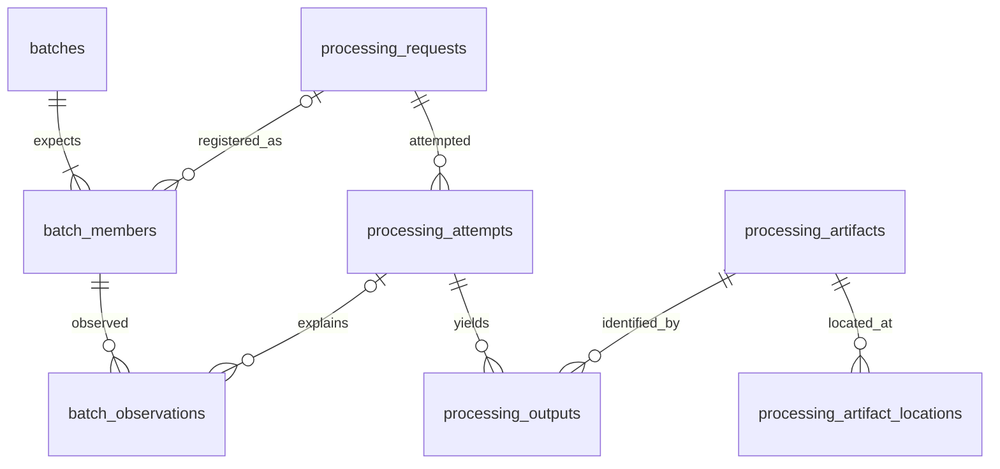

# Lab 05 database contract

Write all three new tables in `student_batch_schema.sql`. The supplied support schemas are completed work from Labs 2–4. Keep their meaning and names.

## Expected work and observations

`batches` needs `batch_id` (text primary key), `manifest_json` (required valid JSON) and `created_at` (required UTC text). The JSON is the frozen scientific membership and execution budget. Runtime paths are separate in the manifest file.

`batch_members` needs `batch_id`, `member_id`, `planned_request_id`, `request_id` and `spec_json`. All are required except `request_id`, which stays NULL until the coordinator registers the request. The pair `(batch_id, member_id)` is the primary key. A planned request may appear only once within one batch. A member belongs to an existing batch. A non NULL `request_id` references `processing_requests` and must equal `planned_request_id`. `spec_json` contains valid JSON. The planned identity is deliberately not a foreign key: expected work can exist before a processing request does.

`batch_observations` needs `observation_id` (automatically assigned increasing integer primary key), `batch_id`, `member_id`, `observed_at`, `state`, `reason`, `attempt_id`, and `evidence_json`. All are required except `attempt_id`. The batch/member pair references an existing member. A supplied attempt ID references `processing_attempts`. A state is one of `ready`, `complete`, `blocked`, `unresolved`, `failed`. The reason is nonempty text. Evidence is valid JSON. Several observations must be allowed for the same member. Add an index beginning with `(batch_id, member_id)` and ending with `observation_id`.

Enable foreign keys on every connection. Use explicit NOT NULL constraints for text primary keys. The application appends observations; it never rewrites them to hide an earlier failure. The schema alone does not make that application policy tamper proof.

## What each state establishes

| State | Meaning at the observation time | Next action |
|---|---|---|
| ready | Inputs are verified and the execution budget permits an attempt | Launch through the adapter |
| complete | A succeeded producing attempt has an output with verified bytes, grid and request/attempt tags | Retain it; scientific QC still needs its own evidence |
| blocked | Required bytes are unavailable, or the catalogue has another unresolved execution | Inspect the input or active attempt |
| unresolved | This request has an attempt still marked running | Establish whether it stopped, then reconcile |
| failed | Validation or an application failure needs investigation, or the budget is exhausted | Inspect the retained evidence; do not retry blindly |

`unobserved` is a report label for a member with no observation. It is not an observation state. A left join preserves such members.

Historical attempt outcomes do not change when a file disappears. A result can remain complete when source files have moved if the output itself still passes verification. A missing output with usable inputs may become ready for recovery. Its location checks explain why.

## Function contracts

`classify_member(context)` returns `state` and a nonempty `reason`. Consider an active attempt first, then a verified output. Inspect validation and missing input evidence before execution eligibility. Count non reused attempts across the catalogue, including earlier batch invocations. A stopped attempt can retry within its budget after reconciliation; an ordinary failed application attempt requires investigation.

`verify_result(member, evidence)` checks exact request identity, nonempty attempt/artifact IDs, positive recorded size, matching measured size and SHA256, and explicit catalogue, grid and provenance verification flags. Missing verification fields must not pass. The adapter obtains the evidence by querying relationships, hashing actual files and reopening rasters; it does not accept those flags from an external untrusted receipt.

`summarize_batch(rows)` returns `expected`, `counts` and `members`. Each row has a `member_id`, `observation_id` and nullable `state`. Use the largest observation ID for each member. Repeated join rows must not multiply members. A NULL observation is represented by ID -1 and state None. Counts include all five observation states plus `unobserved`; their sum equals expected membership. Each state's member list contains exactly its counted IDs in sorted order.

## Existing relationships

